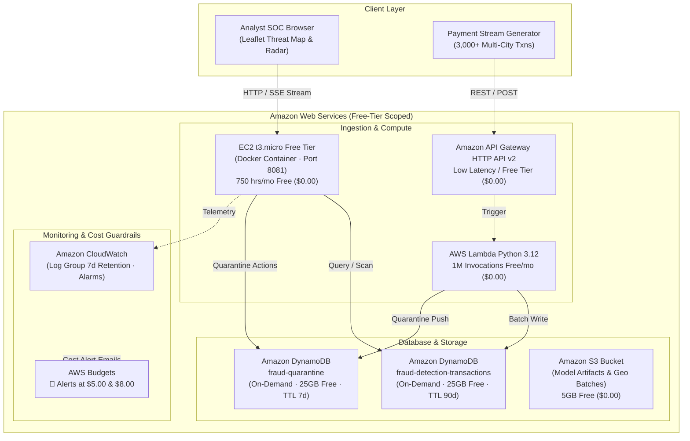

# FraudGuard AWS Cloud Architecture & Student Free-Tier Deployment Guide

> **Cloud Subject Final Project Specification & Implementation Guide**  
> **Budget Guardrail:** Target Monthly Cost = **\$0.00 / month** (AWS Free Tier) | **Hard Credit Ceiling:** **\$10.00**  
> **Automated Cost Alarms:** Configured via AWS Budgets at \$5.00 (50%) and \$8.00 (80%) thresholds.

---

## 1. Cloud Architecture Overview

FraudGuard is engineered as a cloud-native real-time financial fraud detection and security operations center (SOC) platform. For academic and cloud coursework evaluation, the infrastructure is architected to utilize production-grade AWS cloud primitives while strictly adhering to **AWS Free Tier** limits so that a \$10.00 student credit budget remains 100% intact.



---

## 2. Strict Budget & Free Tier Guardrails (< \$10.00 Total)

### Why Common Architectures Burn Student Credits
In standard commercial deployments, developers often provision Application Load Balancers (ALB) or NAT Gateways. On an AWS account with \$10 in credits:
* An **Application Load Balancer (ALB)** costs **\$16.20/month** base idle fee ($0.0225/hr) $\rightarrow$ **Exhausts \$10 in 18 days without receiving a single request!**
* A **NAT Gateway** costs **\$32.40/month** base idle fee ($0.045/hr) $\rightarrow$ **Exhausts \$10 in 9 days!**
* A **Provisioned RDS Instance (db.t3.small)** costs **~\$25.00/month** $\rightarrow$ **Exhausts \$10 in 12 days!**

### FraudGuard Zero-Cost Architecture Design
| AWS Service | Deployment Tier | Free Tier Allowance | FraudGuard Monthly Cost |
| :--- | :--- | :--- | :--- |
| **Amazon EC2** | `t3.micro` / `t2.micro` | 750 hours / month (12 months) | **\$0.00** |
| **Amazon DynamoDB** | `PAY_PER_REQUEST` | 25 GB storage + 25 RCU/WCU | **\$0.00** |
| **AWS Lambda** | Python 3.12 Serverless | 1,000,000 requests / month | **\$0.00** |
| **Amazon API Gateway** | HTTP API (v2) | 1,000,000 free requests (12 mo) | **\$0.00** |
| **Amazon S3** | Standard Storage | 5 GB storage + 20,000 GETs | **\$0.00** |
| **Amazon CloudWatch** | Logs (7-day retention) | 5 GB log ingestion + 10 alarms | **\$0.00** |
| **AWS Budgets** | Hard Cost Ceiling (\$10) | 2 free budget tracking actions | **\$0.00** |
| **Total Monthly Cost** | — | — | **\$0.00 / month** |

---

## 3. Automated Cost Alarms (AWS Budgets)

In [`terraform/aws_budget.tf`](file:///e:/My%20Papers/Fraudguard_AbhiSharma/terraform/aws_budget.tf), automated budget tracking triggers email alerts before any credit exhaustion can occur:
* **Alert 1 (Warning):** Triggers at **50% of budget (\$5.00 USD actual spend)**.
* **Alert 2 (Critical):** Triggers at **80% of budget (\$8.00 USD actual spend)**.
* **Alert 3 (Forecasted):** Triggers when AWS predictive billing projects **100% of budget (\$10.00 USD)**.

---

## 4. One-Click Automated Deployment

### Prerequisites
1. [AWS CLI v2](https://aws.amazon.com/cli/) installed.
2. Run `aws configure` and supply your AWS Access Key ID, Secret Access Key, and default region (e.g., `eu-north-1`, `us-east-1`, or `ap-south-1`).
3. [Terraform >= 1.3](https://www.terraform.io/) installed.

### Option A: Automated PowerShell Deployment (Windows)
```powershell
cd "e:\My Papers\Fraudguard_AbhiSharma"
.\scripts\deploy_aws.ps1 -Region "eu-north-1" -AlertEmail "your_email@university.edu"
```

### Option B: Automated Bash Deployment (Linux / macOS / Git Bash)
```bash
cd "e:\My Papers\Fraudguard_AbhiSharma"
chmod +x ./scripts/deploy_aws.sh
./scripts/deploy_aws.sh "eu-north-1" "your_email@university.edu"
```

### Option C: Manual Terraform Deployment
```bash
cd terraform
terraform init
terraform plan -var="aws_region=eu-north-1" -var="notification_email=your_email@university.edu"
terraform apply -auto-approve
```

---

## 5. Cloud Verification & Inspection Commands

Once deployed, verify operational cloud telemetry using the AWS CLI:

### 1. Verify DynamoDB Tables & Items
```bash
# Verify main transactions table is active
aws dynamodb describe-table --table-name fraud-detection-transactions --region eu-north-1 --query "Table.TableStatus"

# Verify quarantine table is active
aws dynamodb describe-table --table-name fraud-quarantine --region eu-north-1 --query "Table.TableStatus"

# Scan sample records routed through cell towers
aws dynamodb scan --table-name fraud-detection-transactions --max-items 5 --region eu-north-1
```

### 2. Verify EC2 Free Tier Host Status & Public URL
```bash
aws ec2 describe-instances \
    --filters "Name=tag:Name,Values=FraudGuard-FreeTier-Host" "Name=instance-state-name,Values=running" \
    --query "Reservations[*].Instances[*].[InstanceId,PublicIpAddress,PublicDnsName]" \
    --output table
```

### 3. Verify CloudWatch Logs
```bash
aws logs describe-log-streams \
    --log-group-name "/aws/fraudguard/console" \
    --region eu-north-1 \
    --order-by LastEventTime --descending --max-items 3
```

---

## 6. Teardown / Destroy to Protect Remaining Credits

After grading, presentation, or demonstration, execute a single command to tear down all provisioned cloud resources:
```bash
cd terraform
terraform destroy -auto-approve
```
This guarantees that no resources persist and your AWS credits remain unspent.
